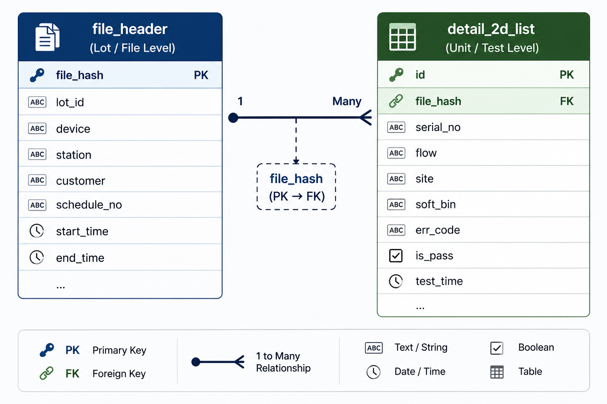

# 📊 SiP Yield Dashboard

Semiconductor final-test analytics platform built with **Python, SQL, DuckDB, Streamlit, and Plotly**. Converts production TXT/LOG files into validated datasets, yield dashboards, and interactive HTML reports.

> Public portfolio data is synthetic and manufacturing identifiers are anonymized. No proprietary manufacturing or customer-sensitive information is included.

## 🎯 Problem and Business Impact

The original reporting process used 60+ device-specific Excel VBA applications across six reporting PCs. This platform consolidates ingestion, analytical processing, and reporting into one configurable solution.

| Area | Previous Workflow | Modernized Platform |
|---|---|---|
| Applications | 60+ Excel VBA applications | One Python loader and dashboard application |
| Infrastructure | Six reporting PCs | One reporting PC |
| Processing time | Approximately 60 minutes distributed across six PCs | 45–75 minutes on one PC |
| Reporting | Manual PowerPoint consolidation | Streamlit dashboards and interactive HTML reports |
| Historical analysis | Separate Excel files | Centralized DuckDB database |
| Late retest records | Manual updates | Rolling one-month backfill |

The platform supports yield monitoring, defect investigation, retest recovery, and historical manufacturing performance analysis.

## 🚀 Interactive Demos

| Dashboard | Focus | Demo |
|---|---|---|
| Daily Yield | FPY, FTY, LRR, defect Pareto, and trends | [Open](https://kenbugasto.github.io/semiconductor-yield-dashboard/demo/SIP_DV16_FUNC1_Daily_Yield_20260801.html) |
| Retest Analysis | RPR, retest defects, and handler performance | [Open](https://kenbugasto.github.io/semiconductor-yield-dashboard/demo/SIP_DV16_FUNC1_RPR_data_20260801.html) |
| Yearly Performance | YoY KPI analysis | [Open](https://kenbugasto.github.io/semiconductor-yield-dashboard/demo/SIP_YoY_Dashboard.html) |
| Quarterly Performance | QoQ KPI analysis | [Open](https://kenbugasto.github.io/semiconductor-yield-dashboard/demo/SIP_QoQ_Dashboard.html) |
| Monthly Performance | MoM KPI analysis | [Open](https://kenbugasto.github.io/semiconductor-yield-dashboard/demo/SIP_MoM_Dashboard.html) |

HTML demos open directly in a browser without Python or a database connection.

## ⚙️ Workflow and How to Run

### Processing Workflow

1. Discover production TXT/LOG files and retrieve source data from FTP.
2. Scan a rolling one-month window to capture late or regenerated records.
3. Validate scope and schemas, normalize timestamps, and track files using hashes.
4. Load standardized records into DuckDB and remove duplicates.
5. Calculate yield, retest, defect, and historical KPIs using SQL.
6. Serve Streamlit dashboards and export standalone Plotly HTML reports.

In the operational environment, Windows Task Scheduler starts the loader at **04:00** and the reporting stage at **05:00**, subject to successful loader completion. Execution logs are reviewed before publication.

### Run Locally

The commands below are templates. Replace the script names with the repository’s actual filenames.

1. Install Python and the dependencies:

   ```bash
   python -m pip install duckdb pandas numpy streamlit plotly
   ```

   Install any additional packages required by the scripts.

2. Configure `config.ini` with your source paths, DuckDB database path, output directory, and FTP settings where required. Use the supplied configuration structure and keep credentials out of Git.

3. Run the loader:

   🔒 Repository Scope
   
   The production loader is not included because it contains company-specific processing logic and manufacturing business rules. This repository presents the public portfolio components and anonymized reporting outputs.
   
   The workflow description explains the production implementation. The repository does not include everything required to reproduce the complete pipeline locally. Interactive HTML demos can be viewed directly in a browser.

4. After successful ingestion, launch the dashboard:

   ```bash
   python -m streamlit run <sip_dashboard_streamlit_app_V2>.py
   ```

5. Review execution logs and generated outputs. Open exported HTML reports directly in a browser.

The public demonstration requires suitable sample files and configuration; the original production FTP environment is not included.

## 🧩 Data Model

The database separates lot-level metadata from unit-level test records.



| Table | Purpose |
|---|---|
| `file_header` | Production-file and lot-level metadata used for scope selection, traceability, and lot-level analysis |
| `detail_2d_list` | Unit-level test records used for defect, yield, and retest investigations |

`file_hash` provides source-file traceability. Separating metadata from test records reduces duplication and supports both lot-level reporting and detailed unit-level investigation.

## 🛠️ Key Engineering Decisions

- **DuckDB:** Embedded analytical SQL without a separate database server.
- **SQL modeling:** CTEs, joins, window functions, and aggregations support deduplication and manufacturing KPI calculations.
- **Incremental processing:** File hashes skip unchanged inputs and support repeatable reloads.
- **Rolling backfill:** A one-month scan captures delayed uploads and regenerated reports.
- **Statistical targets:** IQR-filtered historical yield data supports three-sigma target estimation, with fallback defaults for limited history.
- **Reporting:** Streamlit provides the application interface; Plotly generates interactive charts and standalone HTML reports.

## 💻 Technology Stack

**Python · SQL · DuckDB · Pandas · NumPy · Streamlit · Plotly · ConfigParser · FTP · Windows Task Scheduler**

## 🛣️ Ongoing Development — Phase 2

The current dashboard uses raw production `.txt` files for yield, retest, and defect analytics.

**Phase 2 is underway** to integrate `.csv` test-parameter data and extend reporting to process capability and parametric trends. These capabilities will support investigation of process shifts alongside yield results.

Development is progressing incrementally because the larger CSV data volumes require additional work on ingestion performance, memory management, and validation before integration into the dashboard.
